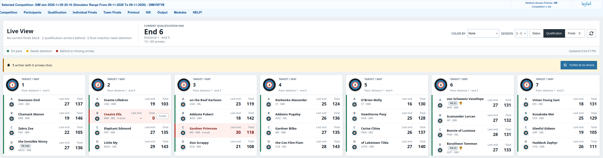
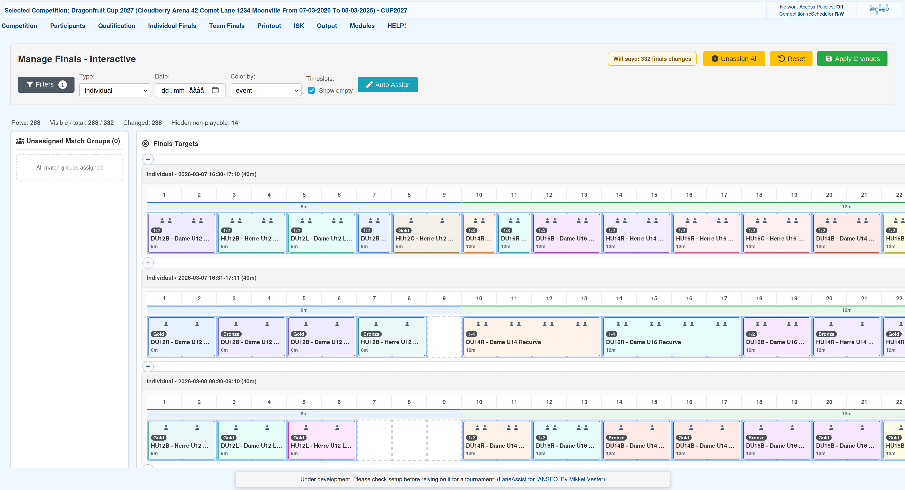
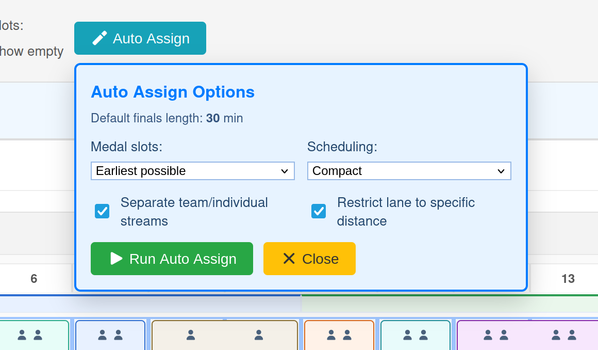
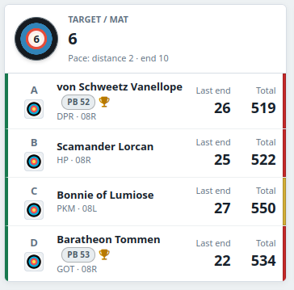

# LaneAssist Module for IANSEO

LaneAssist is a custom IANSEO module focused on faster, easier tournament operations for field-side workflows.

## Screenshots

## What It Adds

LaneAssist adds practical tools on top of IANSEO, including:

- Manage Tournament: where the tournament stands and what needs fixing, plus per-tournament settings (see below)
- Live View: follow the whole field during the tournament (see below)
- Interactive target management (Drag & drop + auto)
- Interactive finals management (Drag & drop + auto)
- Tournament cloning helpers (opened from the Settings page)
- Change finals events: replace a tournament's individual final events with a new set split by gender, class, division or distance, with a preview and a warning listing what will be deleted (opened from Manage Tournament)
- Module settings and update controls

## Manage Tournament

Open **Modules > Manage Tournament** once a tournament is selected. Use it while
planning and while the event runs:

- **Stage** — where the tournament is: Planning, Qualification, Finals or Over.
- **Checklist** — what is not set up yet or is wrong, depending on the stage:
  missing participants, target assignment errors, missing or wrong-sized
  brackets, unscheduled finals, sessions without times, clubs without logos.
  Problems are listed first. Some items have a **Fix** button that sets it up for
  you (e.g. session times, club logos); you are asked to confirm first.
- **Tournament settings** — finals length override and the default Manage
  Targets layout for this tournament.
- **Change finals events** — opens the tool that replaces the individual final
  events.

## Live View

Open **Modules > LaneAssist Live View** once a tournament is selected. The page
refreshes by itself and has two modes, switched with the buttons at the top:

- **Qualification** — every target in the chosen session, with each archer's
  progress and score. The coloured border shows who is on pace, who needs
  attention, and who is behind or missing arrows. Archers who never showed up
  can be forfeited one at a time or all at once. Use **Color by** to group
  archers by club, bow, class or category. A club, bow, category or event keeps
  the same color on every LaneAssist page.
- **Finals** — every match in the current round with its status. Matches with a
  bye or a decided winner can be advanced from here, one at a time or all byes
  at once.

### Personal bests and badges

In Qualification mode, an archer's best earlier qualification score with the
same bow type (from other tournaments in the same IANSEO) is shown next to their
name as a grey **PB** tag. Hover it to see which tournament it was shot at. A
trophy icon appears when the archer is currently beating that score.

Other modules can add their own badges to Live View in the same way. If you
develop modules, see [docs/BadgeProviders.md](docs/BadgeProviders.md).

## Requirements

- A working IANSEO installation
- File access to your IANSEO folder
- Permission to replace files in `Modules/Custom/`

## Install (Recommended)

1. Download the latest **release asset** from GitHub Releases:
   - `laneassist-module-vX.Y.zip`
   - Do not use the automatic `Source code (zip)` archive.
2. Open your IANSEO folder.
3. Go to `Modules/Custom/`.
4. Delete or rename old `LaneAssist` folder if it exists.
5. Extract the release zip so the final path is exactly:
   `Modules/Custom/LaneAssist`
   - You do not need to create the `LaneAssist` folder manually.
   - The release zip already includes the `Modules/Custom/LaneAssist` folder path.
6. Open IANSEO in your browser.
7. Check that these entries are visible under Modules: (Some only when a tournament has been selected)
   - Manage Tournament
   - LaneAssist Live View
   - Manage Targets - Interactive
   - Manage Finals - Interactive
   - LaneAssist Settings

## Update

1. Open the settings page (Modules/Lane Assist Settings)
2. Under Updates, click the "Update Now" button.

## License

Check your IANSEO deployment policies and upstream licensing terms before publishing publicly.
