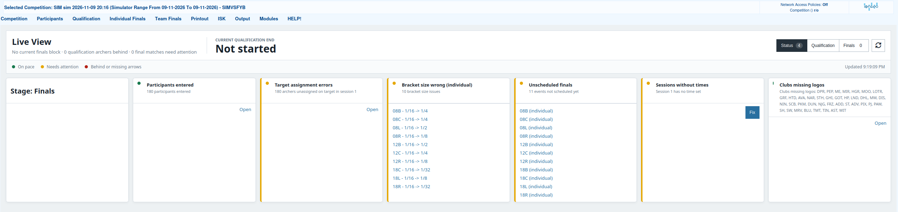
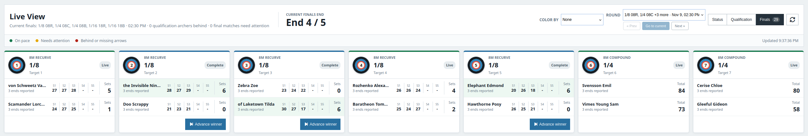
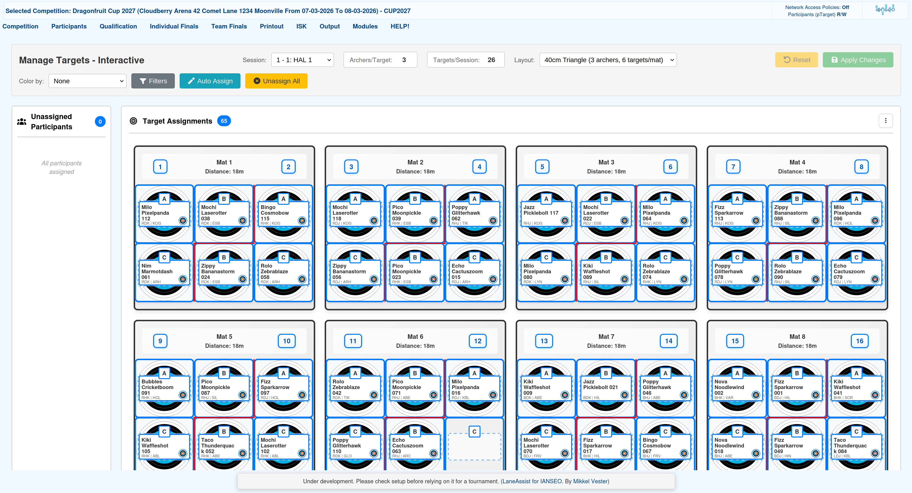
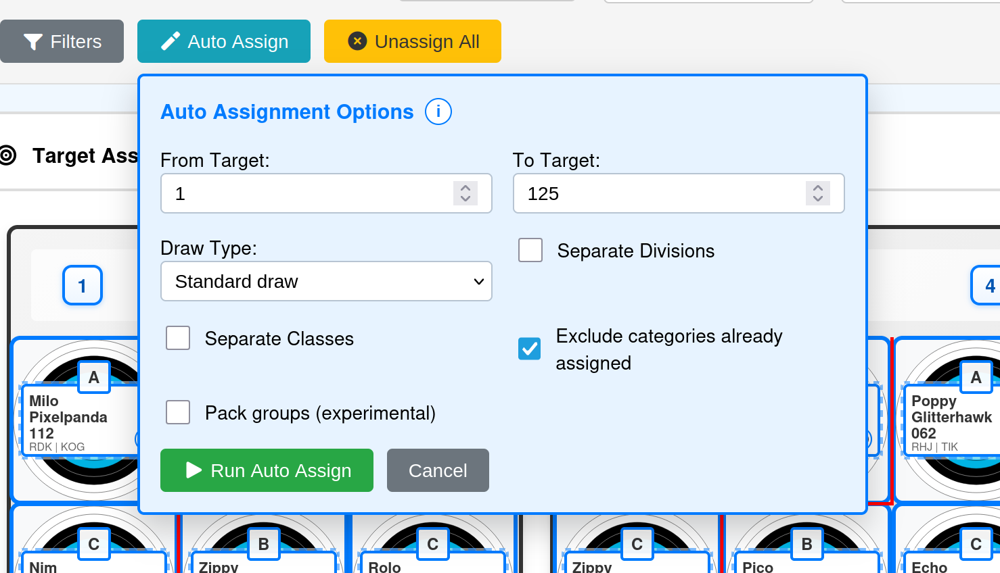
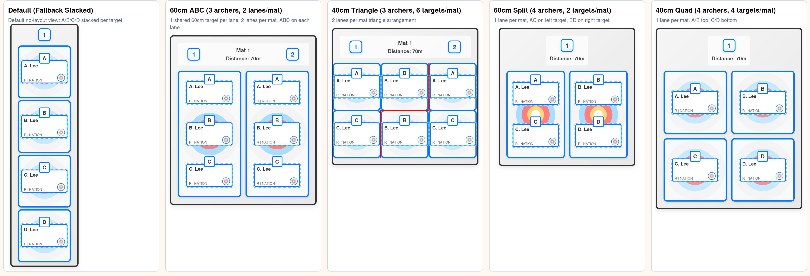
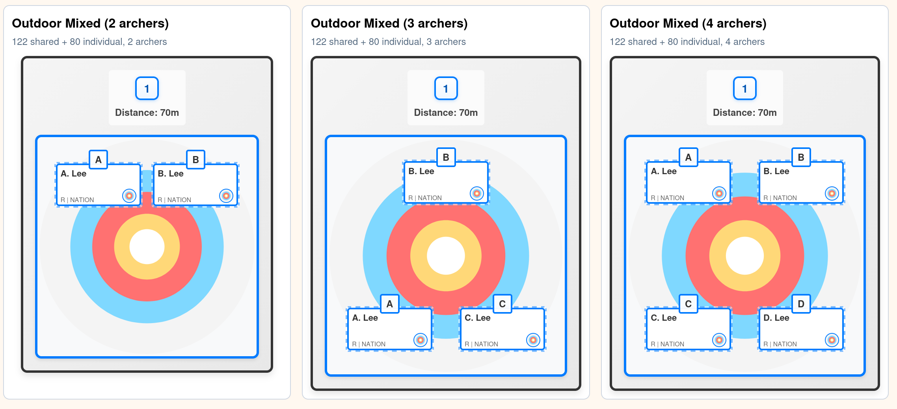
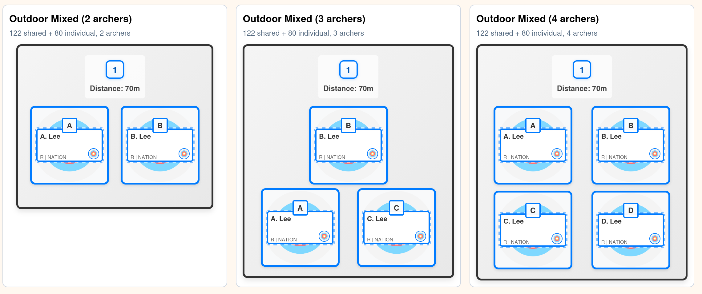

# LaneAssist Module for IANSEO

LaneAssist is a custom IANSEO module focused on faster, easier tournament operations for field-side workflows.

## Screenshots

## What It Adds

LaneAssist adds practical tools on top of IANSEO, including:

- Live View: follow the whole field during the tournament (see below)
- Interactive target management (Drag & drop + auto)
- Interactive finals management (Drag & drop + auto)
- Tournament cloning helpers (opened from the Settings page)
- Module settings and update controls

## Live View

Open **Modules > LaneAssist Live View** once a tournament is selected. The page
refreshes by itself and has three modes, switched with the buttons at the top:

- **Status** — a checklist of what is not set up yet, depending on where the
  tournament is (planning, qualification, finals, or over): missing
  participants, target assignment errors, missing or wrong-sized brackets,
  unscheduled finals, sessions without times, clubs without logos. The number on
  the button is how many items need attention. Some items have a **Fix** button
  that sets it up for you (e.g. session times, club logos); you are asked to
  confirm first.
- **Qualification** — every target in the chosen session, with each archer's
  progress and score. The coloured border shows who is on pace, who needs
  attention, and who is behind or missing arrows. Archers who never showed up
  can be forfeited one at a time or all at once. Use **Color by** to group
  archers by club, class or division.
- **Finals** — every match in the current round with its status. Matches with a
  bye or a decided winner can be advanced from here, one at a time or all byes
  at once.

### Personal bests and badges

In Qualification mode, an archer's best earlier qualification score with the
same bow type (from other tournaments in the same IANSEO) is shown next to their
name as a grey **PB** tag. Hover it to see which tournament it was shot at. A
trophy icon appears when the archer is currently beating that score.

Other modules can add their own badges to Live View in the same way. If you
develop modules, see [docs/BadgeProviders.md](docs/BadgeProviders.md).

## Requirements

- A working IANSEO installation
- File access to your IANSEO folder
- Permission to replace files in `Modules/Custom/`

## Install (Recommended)

1. Download the latest **release asset** from GitHub Releases:
   - `laneassist-module-vX.Y.zip`
   - Do not use the automatic `Source code (zip)` archive.
2. Open your IANSEO folder.
3. Go to `Modules/Custom/`.
4. Delete or rename old `LaneAssist` folder if it exists.
5. Extract the release zip so the final path is exactly:
   `Modules/Custom/LaneAssist`
   - You do not need to create the `LaneAssist` folder manually.
   - The release zip already includes the `Modules/Custom/LaneAssist` folder path.
6. Open IANSEO in your browser.
7. Check that these entries are visible under Modules: (Some only when a tournament has been selected)
   - LaneAssist Live View
   - Manage Targets - Interactive
   - Manage Finals - Interactive
   - LaneAssist Settings

## Update

1. Open the settings page (Modules/Lane Assist Settings)
2. Under Updates, click the "Update Now" button.

## License

Check your IANSEO deployment policies and upstream licensing terms before publishing publicly.
