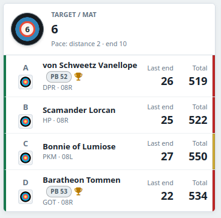

# Badge providers (for module developers)

Live View can show badges next to archers in **Qualification** mode. LaneAssist
doesn't decide what a badge means. Any module installed under `Modules/Custom/`
can add badges, and LaneAssist only validates and draws them.

LaneAssist's own personal-best badges use this same mechanism, with no special
treatment. [`laneassist-badges.php`](../laneassist-badges.php) is the reference
implementation.

## Badge kinds



| Kind | Where it is drawn | Fields used |
|---|---|---|
| `pill` (default) | Small tag beside the archer's name | `label` (the text), `color` (background), `textColor`, `title` |
| `icon` | Font Awesome icon beside the name | `icon` (e.g. `fa-trophy`), `color`, `label` (used as the `aria-label`), `title` |
| `edge` | 4px colour strip down the right border of the archer's row. With several edge badges, the strip is split into equal segments | `color`, `title`. `label` is required but not shown |

`title` is the hover tooltip. It is optional for every kind.

The personal-best provider uses `pill` (grey "PB 642") and `icon` (trophy for
a new personal best). Nothing that ships with LaneAssist uses `edge` yet.

## Registering a provider

1. Create `Modules/Custom/<YourModule>/laneassist-badges.php`. LaneAssist finds
   every file matching `Modules/Custom/*/laneassist-badges.php` on each Live
   View refresh, in alphabetical order by path.
2. In that file, register a callable under your module's name:

```php
<?php

if (!function_exists('yourModuleBadges')) {
    function yourModuleBadges(array $archers, array $context) {
        $out = [];
        foreach ($archers as $archer) {
            if ($archer['totalPoints'] >= 600) {
                $out[$archer['participantId']][] = [
                    'kind'  => 'pill',
                    'label' => '600+',
                    'color' => '#2e7d32',
                    'textColor' => '#ffffff',
                    'title' => 'Scored 600 or more',
                ];
            }
        }
        return $out;
    }
}

$GLOBALS['LANEASSIST_BADGE_PROVIDERS']['YourModule'] = 'yourModuleBadges';
```

Give your function a name prefixed with your module, so it can't collide with
another provider's. The `function_exists()` guard follows the same pattern as the
reference implementation.

The file runs only while Live View builds its data, not when IANSEO draws the
menu. Don't put a provider in `menu.php`.

## Input

`$archers` holds every archer in the selected session. Each entry has, among
others:

| Key | Meaning |
|---|---|
| `participantId` | IANSEO `EnId`. Use it as the key in your result |
| `firstName`, `lastName`, `name` | Archer name |
| `club` | Country/club code |
| `event`, `division`, `class` | Event code, bow type, age/gender class |
| `totalPoints` | Current qualification score |
| `arrowsShot`, `totalArrows` | Progress |
| `retired` | `true` if forfeited |
| `personalBest`, `personalBestCompetitionName`, `hasNewPersonalBest` | Filled in by LaneAssist before providers run |

`$context` describes the tournament, so a provider doesn't need to query the
`Tournament` row itself:

| Key | Meaning |
|---|---|
| `tourId` | Tournament id |
| `session` | Selected qualification session |
| `phase` | Always `'qualification'` for now |
| `toTypeName`, `toNumDist`, `toMaxDistScore` | Round type, number of distances, maximum score per distance |
| `toLocRule` | Local rule set |

If your badges depend on the round, match on `toNumDist` and `toMaxDistScore` as
well as `toTypeName`. The same type name can be used with different distance
setups (e.g. an indoor 18 m round as 2×300 or 1×300).

## Output

Return an array of `participantId => list of badges`. Leave out archers that
have no badges.

Every badge must have a non-empty `label`. LaneAssist drops a badge, and keeps
the rest, if:

- `label` is missing or empty
- `kind` is something other than `pill`, `icon` or `edge`
- an `icon` badge's `icon` doesn't match `fa-[a-z0-9-]` (up to 40 characters)

Colours must be `#rrggbb`. Any other value falls back to a default colour (light
grey background, black text and icons). All text is HTML-escaped, so you can't
inject markup through `label` or `title`.

## Failure isolation

Providers are third-party code, so LaneAssist runs each one in isolation:

- The include and the call each run in their own output buffer, which is
  thrown away afterwards. If you `echo` or trigger a notice, the output can't
  corrupt Live View's JSON.
- Exceptions and errors (`Throwable`) are caught. A provider that throws adds
  no badges, and the error is written to the PHP error log with the file path.
- If the result isn't an array, it is ignored.

If something fails, only your badges go missing. Check the PHP error log
for `LaneAssist badge provider`.

Your module must not depend on LaneAssist being installed, and LaneAssist
doesn't depend on your module. The only connection is the
`laneassist-badges.php` file.
